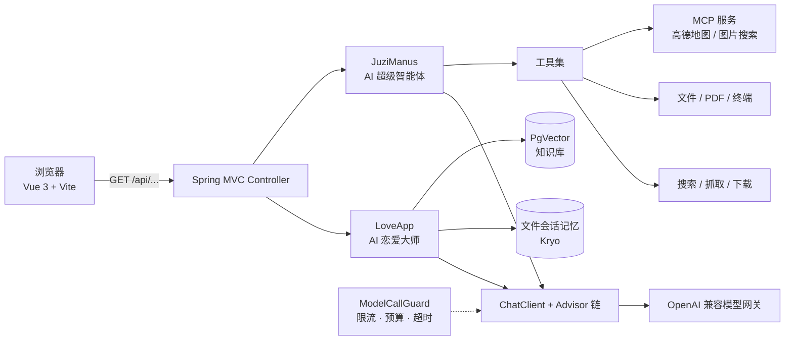

# 橘子 AI 智能体（Juzi AI Agent）

一个前后端分离的全栈 AI Agent 实践项目：后端基于 **Spring Boot 3 + Spring AI**，前端基于 **Vue 3 + TypeScript + Vite**。

项目提供两个入口：

- **AI 恋爱大师**：情感陪伴对话，内置亲密关系知识库（RAG），支持多轮会话记忆；
- **AI 超级智能体 Manus**：会自主调用工具完成任务（联网搜索、网页抓取、文件读写、PDF 生成等），最多 20 步。


---

## ✨ 功能特性

### AI 恋爱大师

- **三阶段对话**：围绕单身、恋爱、已婚三种状态引导用户描述问题，给出针对性建议。
- **RAG 知识库**：内置 41 篇亲密关系 Markdown 文档（理论 + 实战），通过 `TokenTextSplitter` 切分、关键词增强、查询改写后检索，并按 `单身 / 恋爱 / 已婚 / 通用` 元数据过滤。
- **多轮会话记忆**：基于 Kryo 的文件持久化记忆，默认磁盘保留 200 条、上下文中使用最近 20 条；支持原子写入与损坏记录保护。
- **三种输出方式**：同步返回、`Flux` 流式、`SseEmitter` 流式，均共用同一套调用限制与日志策略。

### AI 超级智能体（Manus）

- **ReAct / ToolCall 双引擎**：`BaseAgent → ReActAgent / ToolCallAgent → JuziManus`，按思考-行动循环逐步执行任务。
- **过程可见**：思考、工具调用、工具结果通过 SSE 实时推给前端，任务完成给出最终答复。
- **内置工具集**：

  | 工具 | 能力 | 默认启用 |
  | --- | --- | --- |
  | `WebSearchTool` | 联网搜索（SearchAPI） | ✅ |
  | `WebScrapingTool` | 网页抓取与正文提取 | ✅ |
  | `ResourceDownloadTool` | 下载网络资源到本地 | ✅ |
  | `FileOperationTool` | 读写本地 UTF-8 文本 | ✅ |
  | `PDFGenerationTool` | 将文本渲染为中文 PDF | ✅ |
  | `TerminalOperationTool` | 执行终端命令 | ⛔ 默认关闭，`app.tools.terminal.enabled=true` 显式开启 |
  | `TerminateTool` | 显式结束任务并给出最终答案 | ✅ |

### 通用能力

- **OpenAI 兼容模型接入**：任意 OpenAI 兼容网关（DeepSeek、硅基流动、百炼等）均可使用，模型名与地址全部外置到配置。
- **MCP 支持**：通过 stdio / SSE 接入 MCP 服务，仓库内自带**图片搜索 MCP**（Pixabay），可接入高德地图 MCP。
- **标准 SSE 协议**：`delta` 增量、`error` 错误、`done` 结束、15 秒心跳，中文不乱码；前端手工解析（不使用 `EventSource`）。
- **成本与稳定性防护**：全局 `ModelCallGuard` 限制输入 4000 字符、单次输出 2048 token、并发 2、每分钟 20 次；普通聊天 2 分钟、Manus 5 分钟超时；单条工具结果默认截断到 6000 字符。
- **安全边界**：文件工具只接受普通文件名（禁止路径穿越），网络工具只允许公网 HTTP/HTTPS，日志默认不记录用户正文。
- **接口文档**：集成 Knife4j / OpenAPI，启动后访问 `/api/doc.html`。

---

## 🧱 技术栈

| 层次 | 选型 |
| --- | --- |
| 后端框架 | Spring Boot 3.5.8、Spring AI 1.1.2、Spring AI Alibaba 1.1.2.0、Spring MVC |
| 模型接入 | `spring-ai-starter-model-openai`（OpenAI 兼容）、`spring-ai-alibaba-starter-dashscope`（可选） |
| 向量检索 | PostgreSQL + pgvector、HNSW 索引、1024 维、余弦距离 |
| Agent / 工具 | Spring AI ToolCallback、MCP Client（stdio / SSE） |
| 会话记忆 | Kryo 序列化 + 文件持久化 |
| 前端 | Vue 3.5、TypeScript 5.7、Vite 6、Vue Router 4、Axios |
| 文档 / 工具库 | Knife4j 4.4、Hutool 5.8、Jsoup 1.19、iText 9（中文 PDF） |
| 部署 | Docker 多阶段构建（amazoncorretto 21） |

---

## 🏗️ 系统架构



请求链路：

1. 前端以 `fetch + ReadableStream` 请求后端（`/api` 由 Vite 代理到 `127.0.0.1:8123`）；
2. Controller 校验参数后交给 `LoveApp` 或 `JuziManus`；
3. `ModelCallGuard` 在进入模型前完成长度、频率、并发与超时约束；
4. 恋爱助手经 RAG 检索 + 会话记忆拼装上下文；Manus 进入工具调用循环；
5. 结果按 SSE 协议逐步推送，前端实时渲染。

---

## 📁 目录结构

```text
juzi-ai-agent/
├── src/main/java/com/yupi/juziaiagent/
│   ├── agent/                # Agent 引擎：BaseAgent / ReActAgent / ToolCallAgent / JuziManus
│   ├── app/                  # LoveApp 恋爱助手
│   ├── advisor/              # 日志、推理增强等 Advisor
│   ├── chatmemory/           # 文件会话记忆（Kryo）
│   ├── config/               # CORS、模型 HTTP 客户端、调用限制
│   ├── constant/             # RAG、文件等常量
│   ├── controller/           # 聊天接口、健康检查、异常处理
│   ├── demo/                 # 模型调用 / RAG 示例代码
│   ├── limits/               # ModelCallGuard 限流与预算
│   ├── rag/                  # 知识库加载、切分、检索、查询改写
│   └── tools/                # 文件、搜索、抓取、下载、PDF、终端工具
├── src/main/resources/
│   ├── document/             # 亲密关系知识库（Markdown）
│   ├── application.yml       # 公共配置（可提交）
│   ├── application-prod.yml  # 生产配置（可提交，密钥用占位符）
│   ├── application-mcp-image.yml # 图片搜索 MCP 的 SSE 连接配置
│   └── application-local.yml # 本地密钥（已 gitignore，需自行创建）
├── src/test/java/            # 后端测试（默认离线，部分用例需真实 API）
├── juzi-ai-agent-frontend/   # Vue 3 前端
├── juzi-image-search-mcp/    # 独立的图片搜索 MCP 服务
├── docs/                     # 接口、性能、安全、运维等文档
├── docker/maven-settings.xml # 构建用 Maven 镜像配置
├── Dockerfile                # 后端镜像（多阶段构建）
└── AGENTS.md                 # 面向 AI 协作者的工程约定（命令、测试红线、架构约束）
```

---

## 🚀 快速开始

### 0. 环境要求

| 依赖 | 版本 | 说明 |
| --- | --- | --- |
| JDK | 17+ | 项目编译目标为 17；Docker 镜像使用 21 |
| Maven | 3.9+ | 或直接使用仓库自带的 `mvnw` / `mvnw.cmd` |
| Node.js | 18+ | 前端构建与开发服务器 |
| PostgreSQL | 14+ | 需安装 `pgvector` 扩展（RAG 可选，但建议开启） |
| 模型服务 | OpenAI 兼容 | 需要 `base-url`、`api-key`、模型名 |
| SearchAPI | — | 联网搜索工具需要 API Key（可先不配，不影响启动） |

### 1. 克隆项目

```bash
git clone https://github.com/holic-f/juzi-ai-agent.git
cd juzi-ai-agent
```

### 2. 初始化数据库（启用 RAG 时需要）

```sql
CREATE DATABASE yu_ai_agent;

\c yu_ai_agent
CREATE EXTENSION IF NOT EXISTS vector;
```

> 向量维度默认 **1024**，必须与 Embedding 模型输出维度一致；不一致时同步修改 `spring.ai.vectorstore.pgvector.dimensions`。

### 3. 创建本地配置 `src/main/resources/application-local.yml`

该文件已被 `.gitignore` 忽略，**不会**随仓库分发，需要自行创建。示例（所有值都换成你自己的）：

```yaml
spring:
  ai:
    model:
      chat: openai          # 使用 OpenAI 兼容模型
      embedding: openai
    dashscope:
      enabled: false        # 不用 DashScope 原生模型时关闭，避免缺少 api-key 启动失败
    openai:
      base-url: https://你的模型网关地址/v1
      api-key: 你的模型服务密钥
      chat:
        completions-path: /chat/completions   # 按网关文档填写
        options:
          model: 你的模型名称
    mcp:
      client:
        enabled: true
        type: SYNC
        toolcallback:
          enabled: true
        stdio:
          connections:
            amap-maps:
              command: npx.cmd
              args: ["-y", "@amap/amap-maps-mcp-server"]
              env:
                AMAP_MAPS_API_KEY: 你的高德Key
    vectorstore:
      pgvector:
        index-type: HNSW
        dimensions: 1024
        distance-type: COSINE_DISTANCE
        max-document-batch-size: 10000
  datasource:
    url: jdbc:postgresql://127.0.0.1:5432/yu_ai_agent
    username: postgres
    password: 你的数据库密码
app:
  ai:
    demo-enabled: false     # 不在启动时执行付费的演示调用
  rag:
    enabled: true           # 启用向量知识库
    pgvector-enabled: true  # 使用 PgVector 作为向量存储
    cloud-enabled: false    # 不启用阿里云 RAG
search-api:
  api-key: 你的SearchAPI Key
```

> 不配置 RAG 时，可将 `app.rag.enabled`、`app.rag.pgvector-enabled` 设为 `false`，无需数据库与 Embedding 模型。
> 终端工具默认关闭；确需使用时在可信环境加 `app.tools.terminal.enabled: true`。

### 4. 启动后端

```bash
# macOS / Linux
./mvnw spring-boot:run

# Windows
mvnw.cmd spring-boot:run
```

启动后：

- 健康检查：<http://127.0.0.1:8123/api/health> → `ok`
- 接口文档：<http://127.0.0.1:8123/api/doc.html>

### 5. 启动前端

```bash
cd juzi-ai-agent-frontend
npm install
npm run dev
```

打开 <http://127.0.0.1:5173>，首页选择「AI 恋爱大师」或「AI 超级智能体」进入对话。

> 前端开发服务器固定监听 `127.0.0.1:5173`，并将 `/api` 代理到 `http://127.0.0.1:8123`。生产构建：`npm run build`，产物在 `juzi-ai-agent-frontend/dist/`。

### 6. （可选）启动图片搜索 MCP

```bash
cd juzi-image-search-mcp
# 先以 sse profile 启动图片服务（需要 Pixabay Key，监听 8127）
PIXABAY_API_KEY=你的Key ./mvnw spring-boot:run -Dspring-boot.run.profiles=sse
```

再以 `local,mcp-image` profiles 启动主项目，即把图片搜索接入恋爱助手：

```bash
./mvnw spring-boot:run -Dspring-boot.run.profiles=local,mcp-image
```

详见 [docs/image-search-mcp.md](docs/image-search-mcp.md)。

---

## 🐳 Docker 部署

仓库内置多阶段 `Dockerfile`，**只构建后端**（前端请单独 `npm run build` 后交给 Nginx 或静态服务器托管，并把 `/api` 反向代理到后端）：

```bash
docker build -t juzi-ai-agent .
docker run -d --name juzi-ai-agent \
  -p 8123:8123 \
  -e SPRING_PROFILES_ACTIVE=prod \
  -v /your/config/application-prod.yml:/app/config/application-prod.yml:ro \
  -v /your/data/tmp:/app/tmp \
  juzi-ai-agent
```

- 运行时可通过环境变量或挂载 `/app/config/application-prod.yml` 注入数据库、模型密钥；
- 应用会把会话记忆、生成文件写入 `${user.dir}/tmp`，建议挂载持久化；
- 生产配置默认不开放本机监听限制，暴露到公网前请自行补上层鉴权与 TLS。

---

## 🔌 接口一览

所有聊天接口均为 `GET`，参数走 query string，无请求体。完整契约见 [docs/api.md](docs/api.md)。

| 方法 | 路径 | 返回 | 用途 |
| --- | --- | --- | --- |
| GET | `/api/ai/love_app/chat/sync` | `text/plain` | 恋爱助手同步对话 |
| GET | `/api/ai/love_app/chat/mcp` | `text/plain` | 恋爱助手 + MCP 工具 |
| GET | `/api/ai/love_app/chat/sse` | `text/event-stream` | 恋爱助手流式对话 |
| GET | `/api/ai/love_app/chat/sse/event` | `text/event-stream` | 同上（带 event 包装） |
| GET | `/api/ai/love_app/chat/sse/emitter` | `text/event-stream` | 同上（`SseEmitter` 实现） |
| GET | `/api/ai/manus/chat` | `text/event-stream` | **超级智能体 Manus** 流式对话 |
| GET | `/api/health` | `text/plain` | 健康检查 |

通用参数：

| 参数 | 适用接口 | 说明 |
| --- | --- | --- |
| `message` | 全部聊天接口 | 用户输入，需 URL 编码，默认上限 4000 个 Unicode 字符 |
| `chatId` | 仅恋爱助手 | 会话 ID，用于多轮记忆；Manus 每次请求新建实例，不接收该参数 |

Manus 的 SSE 帧：

```text
:connected                       # 连接建立
event:delta
data:{"delta":"片段"}             # 增量正文（JSON 封装，保留空格与换行）
:heartbeat                       # 每 15 秒一次注释帧
event:error
data:任务执行失败，请稍后重试。     # 错误只发一次，之后仍会发送 done
event:done
data:[DONE]                      # 唯一的结束信号
```

> `[DONE]` 只有出现在 `event:done` 中才代表结束；正文里的 `[DONE]` 属于内容，不能据此中断。

---

## ⚙️ 主要配置项

| 配置 / 环境变量 | 默认值 | 说明 |
| --- | --- | --- |
| `MODEL_MAX_INPUT_CHARS` | `4000` | 单次输入最大 Unicode 字符数 |
| `MODEL_MAX_OUTPUT_TOKENS` | `2048` | 单次模型输出上限 |
| `MODEL_MAX_CONCURRENT_TASKS` | `2` | 同时在执行的任务数 |
| `MODEL_MAX_TASKS_PER_MINUTE` | `20` | 滚动每分钟接受任务数 |
| `MODEL_CHAT_TIMEOUT` | `2m` | 普通聊天总超时 |
| `MODEL_MANUS_TIMEOUT` | `5m` | Manus 总超时 |
| `MODEL_MANUS_MAX_STEPS` | `20` | Manus 最大执行步数 |
| `MANUS_MODEL` | 空 | 仅覆盖 Manus 模型，留空沿用全局模型 |
| `MANUS_MAX_TOOL_RESULT_CHARS` | `6000` | 单条工具结果写入上下文的上限（最小 256） |
| `CHAT_MEMORY_MAX_STORED_MESSAGES` | `200` | 会话记忆磁盘保留条数 |
| `CHAT_MEMORY_MAX_CONTEXT_MESSAGES` | `20` | 模型使用的历史消息条数 |
| `CHAT_LOG_INCLUDE_CONTENT` | `false` | 是否允许 DEBUG 日志输出聊天正文 |
| `APP_TOOLS_TERMINAL_ENABLED` | `false` | 是否注册终端工具 |
| `IMAGE_SEARCH_MCP_URL` | `http://127.0.0.1:8127` | 图片搜索 MCP 服务地址 |

---

## 🧪 测试

### 后端

```bash
# 单个测试类（Windows 用 mvnw.cmd）
./mvnw -Dtest=AgentFlowTest test
```

默认离线的测试示例：`AgentFlowTest`、`ToolResultCompactorTest`、`OpenAiCompatibilityTest`、`WebScrapingToolTest`、`PDFGenerationToolTest`、`FileOperationToolTest`、`SafeHttpClientTest`、`ModelCallGuardTest`、`LocalAccessConfigTest` 等。

> ⚠️ **不要直接执行 `./mvnw test` 全量测试**：`LoveAppTest`、`JuziManusTest`、`WebSearchToolTest`、`PgVectorVectorStoreConfigTest` 等会调用真实大模型 / 搜索 API / 写入向量库，产生费用和副作用。分类细则见 [AGENTS.md](AGENTS.md#3-测试成本分级红线)。

### 前端

```bash
cd juzi-ai-agent-frontend
npm test        # node --test tests/*.test.mjs
npm run build   # vue-tsc -b && vite build
```

---

## 📚 文档索引

| 文档 | 内容 |
| --- | --- |
| [docs/api.md](docs/api.md) | 接口契约、SSE 帧协议、错误语义 |
| [docs/model-limits.md](docs/model-limits.md) | 输入/输出/并发/频率/超时限制 |
| [docs/chat-memory.md](docs/chat-memory.md) | 文件会话记忆的并发、保留与损坏处理 |
| [docs/chat-logging.md](docs/chat-logging.md) | 聊天日志与正文开关 |
| [docs/tool-security.md](docs/tool-security.md) | 文件、网络、终端工具的访问边界 |
| [docs/image-search-mcp.md](docs/image-search-mcp.md) | 图片搜索 MCP 的启动与接入 |
| [docs/agent-performance.md](docs/agent-performance.md) | Manus 耗时定位与模型对比方法 |
| [docs/local-access.md](docs/local-access.md) | 前后端同机访问与 CORS 说明 |
| [docs/playbooks/](docs/playbooks/) | 新增工具 / 修改 SSE 事件的操作手册 |
| [AGENTS.md](AGENTS.md) | AI 协作须知：命令、测试红线、架构约定 |

---

## 🔐 安全与隐私

- **密钥不入库**：`src/main/resources/application-local.yml` 已被 `.gitignore` 忽略，仓库中不包含任何真实密钥；`application-prod.yml` 只保留占位符。若曾把密钥写入其他文件，请及时在对应平台轮换。
- **工具访问边界**：文件工具只接受普通文件名（拒绝 `../`、绝对路径、设备名、符号链接）；网络工具只允许公网 HTTP/HTTPS，并防止 DNS 重绑定与危险重定向；终端工具默认关闭，开启后即拥有应用进程权限，仅在可信环境使用。
- **日志最小化**：默认只记录耗时、字符数、token 等指标，不打印用户输入、工具结果或答案正文。
- **本机访问**：`local` profile 下后端仅监听 `127.0.0.1`，CORS 只允许本机前端来源。

---

## 🤝 贡献与协议

- 提交代码前请阅读 [AGENTS.md](AGENTS.md)，其中定义了测试成本红线、SSE 协议约束与完成定义（DoD）。
- 本项目目前未附带开源许可证；如需转载或商用，请先联系作者确认。

---

**如果这个项目对你有帮助，欢迎 Star ⭐**